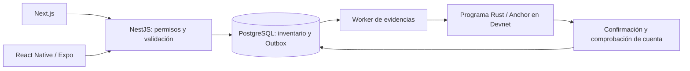

# RepuChain — Inventario y trazabilidad automotriz en Solana

**Cada repuesto tiene una historia. Cada movimiento deja una huella.**

Proyecto final del **Advanced Bootcamp — Solana Engineering Track**. RepuChain administra repuestos, lotes y movimientos de inventario y registra evidencias criptográficas en Solana. PostgreSQL conserva los datos comerciales; la blockchain permite comprobar el historial registrado.

## Ruta, propósito y aporte propio

**Ruta elegida: proyecto propio.** Caso de uso: inventario y trazabilidad de repuestos automotrices. Se utilizan Anchor, Solana Kit, Next.js, NestJS y Prisma como herramientas; la entrega no se presenta como una copia del registro de ventas guiado.

El aporte funcional es conectar inventario por empresa con evidencia encadenada por lote: cada recepción y movimiento genera un hash, una secuencia y una cuenta PDA verificable. La cola Outbox permite reintentar sin duplicar movimientos y evita marcar como confirmada una operación sin comprobar su transacción y cuenta. Compras y ventas actualizan stock de forma transaccional. El acceso se autentica mediante una firma de mensaje de Brave Wallet.

El autor debe revisar y poder explicar el código y las decisiones, incluidos los cambios realizados con asistencia de IA. Las dependencias y sus versiones constan en los manifiestos y lockfiles.

## Correspondencia con los criterios de evaluación

| Criterio | Implementación y comprobación |
| --- | --- |
| Programa, frontend, IDL y cliente | [Programa Anchor](blockchain/programs/repu_chain/src/lib.rs), [frontend](apps/web/src/components/panel/workspace.tsx), [IDL](blockchain/idl/repu_chain.json), [cliente e instrucciones](packages/blockchain-client/src/program.ts). `pnpm blockchain:test` reconstruye el programa y comprueba IDL y Program ID. |
| Cuentas relacionadas y PDAs | Company, Operator, Batch y MovementEvidence; semillas incluyen autoridad, empresa, lote e identificador de evento. [Definiciones](blockchain/programs/repu_chain/src/state) y [derivación de PDAs](packages/blockchain-client/src/program.ts). |
| Creación y lectura | initialize_company y register_batch crean cuentas; el cliente lee cuentas y verify_batch contrasta el estado. [Pruebas de ciclo de vida](blockchain/programs/repu_chain/tests/lifecycle.rs). |
| Modificación | record_movement actualiza secuencia y hash del lote; transfer_custody cambia custodio con autorización. Las pruebas rechazan secuencias y hashes anteriores incorrectos. |
| Autoridad y pertenencia | Firmantes, operadores activos, relaciones has_one y semillas PDA se validan en Rust. Las pruebas rechazan operadores ajenos, revocados y cuentas cruzadas. |
| Baja condicionada | revoke_operator aplica baja lógica mediante active=false; solo la autoridad puede revocar y no puede revocarse a sí misma. Las pruebas `revocation_takes_effect_and_only_authority_can_restore_operator` y `authority_cannot_revoke_itself` demuestran éxito y rechazo. No se implementa cierre físico ni devolución de rent. |
| Firma, confirmación, actualización y errores | Brave firma el reto de acceso. El worker firma las transacciones Solana, espera confirmación y comprueba cuentas antes de mostrar CONFIRMED. Se documentan firmas inválidas, expiración, reintentos y stock insuficiente. |
| Flujo frontend → programa | Panel → API → PostgreSQL/Outbox → worker → Devnet → panel de trazabilidad. Seguir la [demo local para evaluación](docs/development/bootcamp-demo.md). |
| Evidencia verificable | Program ID, recepción y movimiento Devnet enlazados abajo; las pruebas locales cubren permisos, rechazo y baja. |

La baja lógica es la equivalencia propuesta para la ruta propia. Las transacciones comerciales se firman con una autoridad técnica configurada en el worker, no directamente con la wallet de acceso. Revocación y custodia están disponibles en Rust/cliente y pruebas; no tienen pantalla de administración. La evaluación final corresponde al equipo del Bootcamp.

## Datos de entrega

| Dato | Valor |
| --- | --- |
| Repositorio público | [JORGUINHO98/RepuChain-Solana](https://github.com/JORGUINHO98/RepuChain-Solana) |
| Red | Solana Devnet |
| Program ID | `3hgkgx5V7UgU1Dac8R6ZCx2ZYs1PeHPUphFgRmG52GWv` |
| Código del programa | [declare_id! y programa Rust](blockchain/programs/repu_chain/src/lib.rs) |
| Programa desplegado | [Abrir en Solana Explorer](https://explorer.solana.com/address/3hgkgx5V7UgU1Dac8R6ZCx2ZYs1PeHPUphFgRmG52GWv?cluster=devnet) |
| Demo de evaluación | Ejecución local con Brave Wallet y programa en Devnet; no requiere hosting |

El Program ID identifica el programa, no una wallet de usuario.

## Evidencia del funcionamiento

### 1. Despliegue en Devnet

El comprobante del despliegue conserva Program ID, firma, tamaño y hash del binario:
[blockchain/deployments/devnet.json](blockchain/deployments/devnet.json).

- [Transacción de despliegue](https://explorer.solana.com/tx/2uPv2CzKHcEHVpLqDjar4GSMmuoRb4vgNRJ8ZNvnV2dSXJBXjU1pY8YatybMw3AL66WDTnAUJs5WMEW3XHT2D98b?cluster=devnet).
- Tamaño registrado: **254328 bytes**.
- SHA-256 del binario registrado: `9d26e2238c4e71fa46e533ea357b71ca9bacfed2650bd3b0f64b8440e2cb57a8`.
- Comprobación del despliegue registrada el **21 de noviembre de 2026**.

### 2. Recepción y movimiento reales

La demostración usa datos sintéticos y transacciones reales de **Devnet**, sin valor monetario real.
[Comprobante completo con firmas, cuentas y hashes](blockchain/deployments/phase-4-demo.json).

| Evento | Evidencia pública |
| --- | --- |
| Recepción del lote, secuencia 0 | [Transacción](https://explorer.solana.com/tx/cq35KsK8wCfNjRHFSUFRJrCKknB8PTcqNgobkLBMoPeiwjiFj2Xvk68H4dWhBEfU8PiskpDFsMWPyJD3ZC3TEzt?cluster=devnet) · [Cuenta de evidencia](https://explorer.solana.com/address/9YtWiVj3j3T4GCTSb9EPhJphtnf1uurZRHeaGCr5aMuf?cluster=devnet) |
| Movimiento, secuencia 1 | [Transacción](https://explorer.solana.com/tx/4i5s9haKoQtdNv2FL6xZQdmqGrHmVsSdJ5X8FgqG9sZjH8qdQ2grxkL6voDFTq1vvMaF5bBv3VQkDp3SvnxQADZW?cluster=devnet) · [Cuenta de evidencia](https://explorer.solana.com/address/J29zYszH3ys1gfJzTZk3oAMXRpzexZryWU86TjNsM1DX?cluster=devnet) |

Lote de la demostración: `39c9648b-3503-4fd4-89d3-afcd8d71e490`.

**Cómo revisar la evidencia:** abrir los enlaces con la red Devnet, comprobar el resultado de las transacciones y contrastar las firmas y cuentas con el comprobante JSON. Los hashes y su encadenamiento se comprueban mediante el cliente y las pruebas del programa descritas abajo. El JSON es un registro de la ejecución; los enlaces permiten contrastarlo con la red.

**Verified Build y security.txt:** aún no se configuraron el distintivo de compilación reproducible de Explorer ni los metadatos security.txt. Las pruebas y comprobaciones del despliegue documentadas aquí no equivalen a ese distintivo ni a una auditoría externa.

### 3. Pruebas automatizadas

Resultados locales del 23 de noviembre de 2026:

| Suite | Resultado observado | Qué comprueba |
| --- | --- | --- |
| Lógica TypeScript | 42 pruebas correctas | Validación, hashes, QR y sesión móvil |
| API HTTP y PostgreSQL | 56 pruebas correctas | Firmas wallet, autenticación, aislamiento, inventario, compras y ventas |
| Programa Rust | 20 pruebas correctas | Autoridades, custodia, secuencias, hashes y rechazo de alteraciones |
| Integración blockchain local | 3 pruebas correctas | API → base → programa SBF, firmas y recuperación RPC |

Son **121 pruebas**, más tres vectores SHA-256 independientes. Las suites indicadas se ejecutaron localmente durante esta actualización. Los tests históricos de correo se conservan solo como fixtures en NODE_ENV=test. El binario recompilado mantiene el hash del comprobante de despliegue y el IDL correspondiente; no se actualizó el programa en Devnet.

También pasaron compilación web/API, exportación JavaScript Android/iOS, validación Prisma, compatibilidad Expo y comprobaciones de sesión web. No se presenta la exportación móvil como una prueba en teléfono.

Fuentes de las pruebas:
[tests/integration](tests/integration) · [tests/e2e](tests/e2e) · [tests/blockchain](tests/blockchain) · [pruebas Rust](blockchain/programs/repu_chain/tests).

No se adjuntan capturas o vídeos simulados. La evidencia disponible consiste en transacciones públicas, comprobantes y pruebas reproducibles.

## Funcionalidades implementadas

- Acceso por firma de wallet Solana; empresa de prueba propia y permisos por empresa.
- Catálogo, marcas, categorías, proveedores y compatibilidad vehicular.
- Almacenes, lotes, existencias, entradas, salidas y transferencias.
- Compras y ventas con importes decimales y actualización transaccional del inventario.
- Dashboard, auditoría y etiquetas QR descargables.
- Cola Outbox, reintentos e idempotencia de movimientos.
- Consulta de evidencia, hashes, estado y enlace a Solana Explorer.
- App Expo: cámara QR, consulta y movimientos implementados; acceso wallet nativo pendiente.

## Arquitectura



Una operación registra stock, movimiento, auditoría y Outbox en una transacción. El worker construye el contenido canónico, calcula hashes, firma, envía y comprueba la transacción y la cuenta antes de marcar **CONFIRMED**. Una evidencia pendiente no se presenta como confirmada.

Los precios y datos comerciales permanecen en PostgreSQL. El programa usa cuentas PDA, secuencia y controles de autoridad. Las pruebas rechazan cuentas de otra empresa, operadores revocados y hashes alterados. La evidencia registra el contenido digital; no certifica por sí sola la autenticidad física de un repuesto.

| Capa | Tecnología |
| --- | --- |
| Web | Next.js 16, React 19, TypeScript |
| Móvil | React Native, Expo SDK 58 |
| API | NestJS, JWT y permisos por rol |
| Datos | PostgreSQL, Prisma |
| Blockchain | Rust, Anchor, Solana Devnet, @solana/kit |
| Repositorio | pnpm workspaces y Turborepo |

Las versiones exactas están fijadas en los manifiestos, lockfiles y archivos de toolchain.

## Ejecutar el proyecto

### Requisitos

Node y pnpm según `.nvmrc` y `package.json`, PostgreSQL accesible y WSL2/Ubuntu para el flujo documentado. Para las pruebas blockchain también se necesitan Rust, Anchor y Solana según los archivos del repositorio.

```bash
git clone https://github.com/JORGUINHO98/RepuChain-Solana.git
cd RepuChain-Solana
pnpm install --frozen-lockfile
pnpm setup:env
```

Configurar la conexión PostgreSQL en los archivos locales de entorno y crear las bases siguiendo la [guía WSL2](docs/development/wsl2.md). No utilizar contraseñas de ejemplo para una publicación.

```bash
pnpm db:migrate
pnpm dev
```

- Web local: http://127.0.0.1:3000
- API local: http://127.0.0.1:4000/api/v1
- Disponibilidad PostgreSQL: /api/v1/health/ready

### Acceso del jurado

En la página inicial elegir **Conectar Brave Wallet** y firmar el mensaje con una cuenta Solana de Brave Wallet. No se requiere correo, contraseña ni SOL para entrar. La primera firma crea una empresa vacía; usar la misma wallet para volver a ese espacio.

La interfaz ofrece únicamente Brave Wallet. En Brave, seleccionar Brave Wallet como cartera predeterminada de Solana en Configuración > Web3. [Flujo, configuración y límites](docs/development/wallet-auth.md).

Las empresas anteriores permanecen guardadas, pero no se vinculan automáticamente a una wallet. El acceso por correo está deshabilitado fuera de las pruebas internas.

Una empresa recién creada no tiene worker blockchain configurado. Puede probar inventario, pero sus evidencias quedarán pendientes. Para evaluar confirmaciones ya realizadas, consultar la demostración Devnet enlazada arriba.

### Recorrido funcional

1. Crear proveedor, almacén y repuesto.
2. Crear un lote del repuesto.
3. Registrar una compra y comprobar el aumento de existencias.
4. Registrar una venta y comprobar la disminución.
5. Intentar una salida superior al stock: debe rechazarse sin cambios parciales.
6. Abrir trazabilidad y consultar el estado real de las evidencias.
7. En Lotes, elegir **Ver QR** para descargar su etiqueta.
Los controles de permisos VIEWER se verifican en las pruebas de API; la invitación de otras wallets a una empresa está pendiente.

Usar datos de prueba para esta demostración.

### Ejecutar las verificaciones

Con la base de pruebas preparada según la guía:

```bash
pnpm db:test:init
pnpm check
pnpm test:integration
pnpm smoke
pnpm mobile:check
pnpm db:check
pnpm blockchain:test
pnpm test:blockchain:integration
```

También existe `node scripts/verify-release.mjs --blockchain`, que ejecuta las verificaciones y escribe resultados y tiempos en `reports/release-check.json`. Se detiene ante un fallo.

Las pruebas HTTP usan una base terminada en `_test`, crean empresas independientes y conservan su historial. Las pruebas blockchain de integración usan un validador local; no requieren publicar claves del despliegue Devnet. Consultar los requisitos de claves locales en la [guía blockchain](docs/blockchain/phase-3.md).

## Configuración y despliegue

| Servicio | Variables principales |
| --- | --- |
| API | DATABASE_URL, JWT_SECRET, HOST, PORT, WEB_ORIGIN, WALLET_AUTH_ORIGINS |
| Web | API_INTERNAL_URL |
| Móvil | EXPO_PUBLIC_API_URL, EXPO_PUBLIC_WEB_URL |
| Worker | DATABASE_URL, BLOCKCHAIN_COMPANY_ID, BLOCKCHAIN_SIGNER_PATH, BLOCKCHAIN_NETWORK, BLOCKCHAIN_RPC_URL |

Los valores privados se configuran fuera de Git. El worker usa un firmante técnico autorizado; no se publican claves personales.

La web está preparada para Vercel con raíz `apps/web`. La API, PostgreSQL y el worker necesitan alojamiento y configuración propios. GitHub contiene el código y no ejecuta automáticamente la app.
[Guía de entrega y despliegue](docs/development/phase-7.md).

## Estado y límites

- Programa y demostración desplegados en Devnet.
- Entrega mediante GitHub y demo local. Los despliegues automáticos de Vercel están deshabilitados por decisión del autor.
- Acceso wallet implementado en la web; integración nativa Expo y prueba física Android pendientes.
- No hay APK publicado ni validación visual completa.
- No hay auditoría de seguridad independiente ni ensayo de carga.
- Facturación fiscal, devoluciones, garantías y recuperación de contraseña no están implementadas.
- Los workflows están incluidos; los resultados de pruebas indicados arriba son **locales**, no una afirmación de CI aprobada en GitHub.

## Documentación

- [Arquitectura](docs/architecture/phase-2.md)
- [Modelo de datos](docs/database/phase-2.md)
- [API](docs/api/phase-2.md)
- [Programa Anchor](docs/blockchain/phase-3.md)
- [Worker, hashes y reintentos](docs/blockchain/phase-4.md)
- [Acceso con wallet](docs/development/wallet-auth.md)
- [Panel web](docs/development/phase-5.md)
- [Aplicación móvil y prueba Android](docs/development/phase-6.md)
- [Entrega y despliegue](docs/development/phase-7.md)
- [Variables de entorno](docs/development/environment.md)
- [Contribuir](CONTRIBUTING.md)
